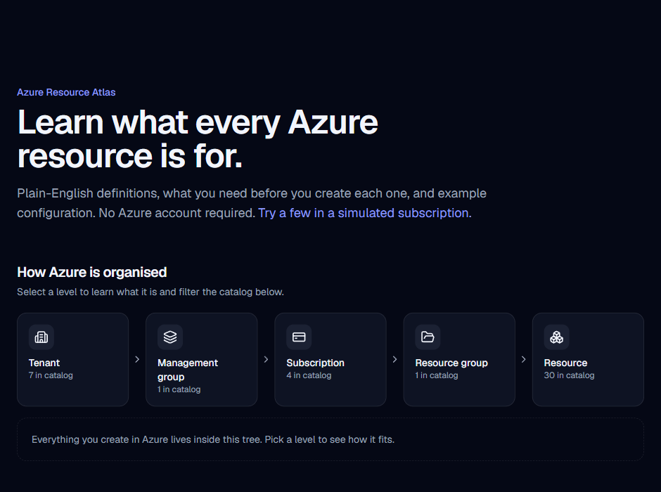
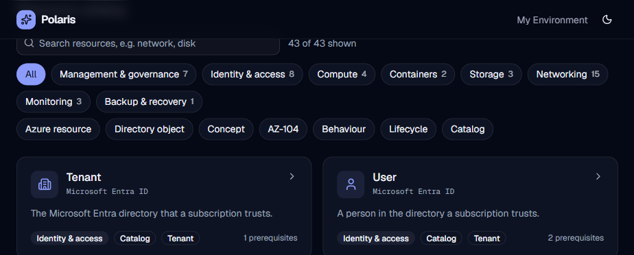
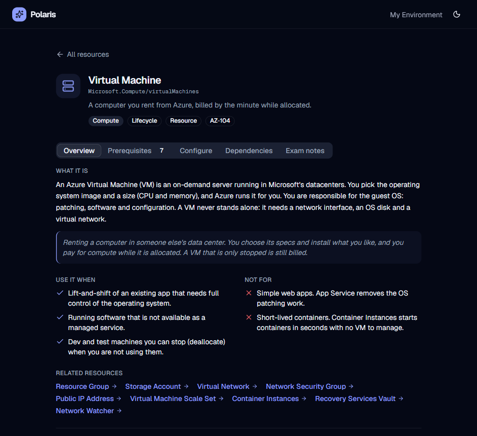
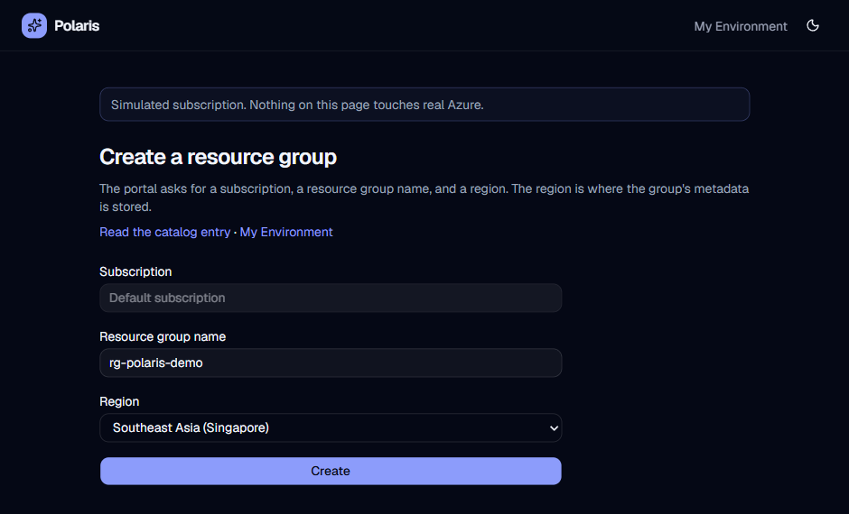
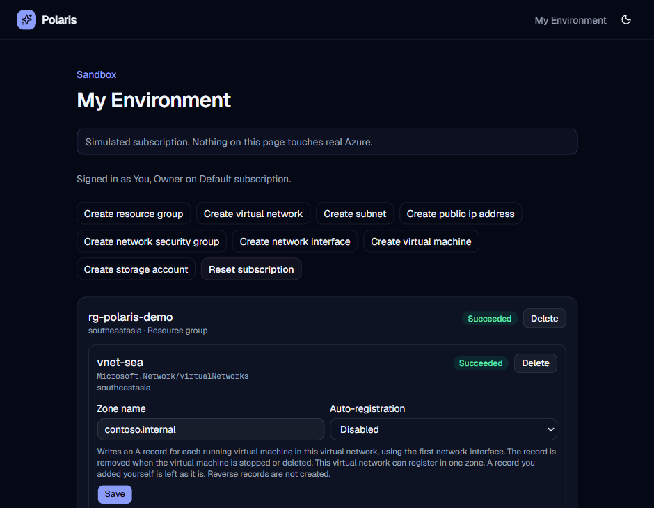

# Polaris

A free, browser-only place to learn and try out Azure. Nothing is hosted, nothing talks to real Azure, and no Azure account is needed.

Polaris has two parts:

- **Atlas:** a catalog of Azure resources. Each entry has a plain-English definition, an analogy, when to use it, prerequisites, example configuration (Portal, Azure CLI, PowerShell, Bicep, ARM), exam notes, a modal, and a shareable page.
- **Sandbox:** a simulated subscription. You can create eight resource types, link them, and ask the engine what a connection would do. State stays in the browser. A simulated Cloud Shell that runs `az` is still to come.

Every fact in the catalog is checked against Microsoft Learn or other official Microsoft documentation.

**Azure only until v1 is finished.** Then review whether it fits, and update the plan if it does not, before any other cloud. See section 10 of `docs/PLAN.md`.

> **Working on this project (human or AI): read [`docs/PLAN.md`](docs/PLAN.md) first.** Section 0 has the current state, the next step, the rules and a map of the docs.

## How it works

### 1. Browse the catalog

The home page is the atlas. The hierarchy (tenant, management group, subscription, resource group, resource) filters the list below it. Search covers names, types, and definitions.



Filters narrow the 43 entries by service area, kind, exam tag, and tier.



### 2. Open an entry

A card opens a shareable page (and, from the catalog, a modal with the same content). The page says what the resource is, when to use it, what it is not for, and which other entries it depends on. Further tabs cover prerequisites, configuration examples, dependencies, and exam notes. **Try it** is enabled only for the resources the sandbox can create.



### 3. Try it in the sandbox

**Try it** opens a create form. The labels follow the portal. The engine runs in the browser and writes the world to `localStorage`. Catalog pages do not load the engine. Nothing on these pages touches a real Azure subscription.



**My Environment** (`/sandbox/`) is the simulated subscription. You are signed in as Owner. Resources you create show up here, and the forms on this page are where links, routes, DNS, and connection checks live.



Try it is on for a resource group, virtual network, subnet, public IP address, network security group, network interface, virtual machine, and storage account. The network interface has no catalog page of its own. The other catalog entries stay documentation until their forms are added.

From My Environment you can also:

- Attach a network interface to a virtual machine, and a public IP to that interface.
- Associate a network security group with a subnet or a network interface, and add one TCP rule on a group that already exists, for internet traffic or virtual-network traffic.
- Add a route on a subnet. `0.0.0.0/0` changes outbound internet traffic after the security groups allow it. A longer prefix can decide an address inside the virtual network.
- Peer two virtual networks. The address check can reach a private address in the peered network. Forwarded traffic needs both links to allow it. Gateway transit can be recorded and does not carry traffic.
- Send traffic to a virtual appliance. The check follows that chain for up to 8 hops.
- Use a Microsoft.Storage service endpoint on the subnet. A user route does not override it.
- Use an approved private endpoint for blob, file, queue, or table when the matching `privatelink` zone is linked to the virtual machine's virtual network. Otherwise the storage name resolves to the public address.
- Resolve a virtual machine name in that virtual network. A linked private DNS zone is checked first. Auto-registration can add a record for a running virtual machine.
- On a virtual machine, check one new inbound TCP connection from the internet, one new outbound TCP connection to the internet, and one new TCP connection to a private address in the same virtual network.

A refusal names the rule and, when the page can fix it, what to do next. The engine also evaluates Azure RBAC and five built-in deny and audit policies. Each network interface shows the private address the sandbox assigned.

## Status

43 entries, including the directory and RBAC entries and Tag, Resource lock, Policy definition, and Policy assignment. The sandbox design is in `docs/SIMULATOR.md`, `docs/RBAC.md` and `docs/CLOUDSHELL.md` (evidence in `docs/research/`). The engine in `src/engine/` evaluates Azure RBAC and five built-in policies. See the roadmap in `docs/PLAN.md`.

## Run it

Requires Node.js and npm.

```bash
npm install
npm run dev        # http://localhost:3000
```

### Docker

The image builds the static export and serves it with nginx. The container does not talk to Azure. Sandbox state stays in the browser.

```bash
docker compose up --build
```

Open http://localhost:8080. `npm run dev` can keep using port 3000.

## Checks

Run these before committing. The first one needs the Bicep CLI.

```bash
BICEP_PATH=/path/to/bicep npm run check:snippets   # compiles every Bicep example, parses every ARM example
npm run lint
npx tsc --noEmit
npm run build                                       # static export; also validates all content
npm test                                            # engine rules
```

If the Bicep CLI is not found, `check:snippets` skips the Bicep checks and says so. Install it with `az bicep install` or from the official Bicep releases.

## How the project is laid out

| Path | What it holds |
|---|---|
| `src/content/schema.ts` | The Zod schema every catalog entry must satisfy |
| `src/content/resources/<slug>.ts` | One file per catalog entry |
| `src/content/index.ts` | Registers entries; at build time checks unique slugs and that cross-references resolve |
| `src/content/hierarchy.ts`, `regions.ts` | Hierarchy levels and the two simulated regions |
| `src/components/` | UI: explorer, hierarchy map, cards, detail view, modal, code blocks |
| `src/components/resource-icon.tsx` | Maps an entry's icon name to a lucide icon |
| `src/app/` | Next.js App Router pages: home, `/resources/<slug>/`, `/sandbox/`, and static JSON used by the modal |
| `src/engine/` | In-browser Azure world. Sandbox pages load it with a dynamic import. Catalog pages do not. |
| `scripts/check-snippets.ts` | The snippet checker |
| `docs/` | Plan (`PLAN.md`), sandbox design (`SIMULATOR.md`, `RBAC.md`, `CLOUDSHELL.md`), backlog, and `research/` (evidence reports with sources) |
| `docs/images/` | Screenshots used in this README |

The site is a static export (`output: "export"`), so it can be hosted anywhere that serves files.

## Adding a catalog entry

1. Read `docs/PLAN.md` section 3 (the rules) first. Sources must be Microsoft Learn or other official Microsoft docs.
2. Copy a recent entry such as `src/content/resources/container-apps.ts` and write the new one from Learn. Each claim (limits, defaults, portal labels, CLI flags, property names) must be verified.
3. Register it in `src/content/index.ts`.
4. If it uses a new lucide icon name, add it to `src/components/resource-icon.tsx`.
5. Add the slug to `related` in the entries it connects to.
6. Run the checks above and look at the page in the browser, including on a phone-width window.

Writing rules for code samples inside the TypeScript template literals: no `${}`, use `\\` for bash line continuation, and `` \` `` for the PowerShell backtick.

## Notes for AI agents

- This project uses a Next.js version with breaking changes. See `AGENTS.md`, and read the guide in `node_modules/next/dist/docs/` before using a Next.js API.

